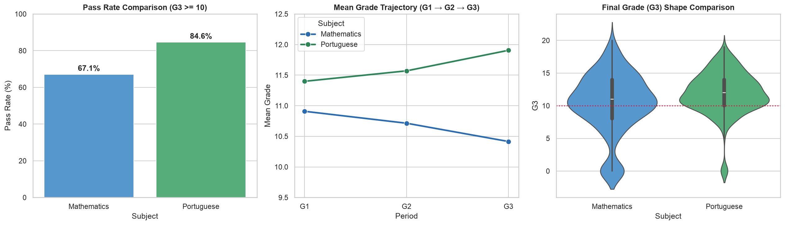
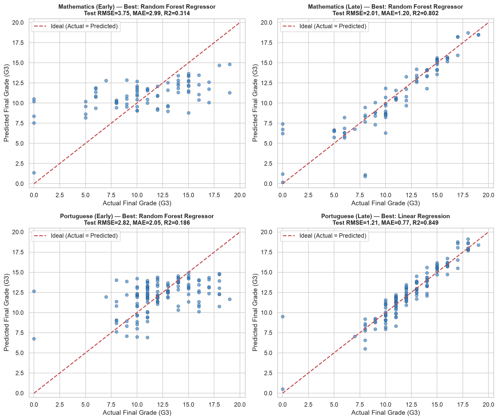
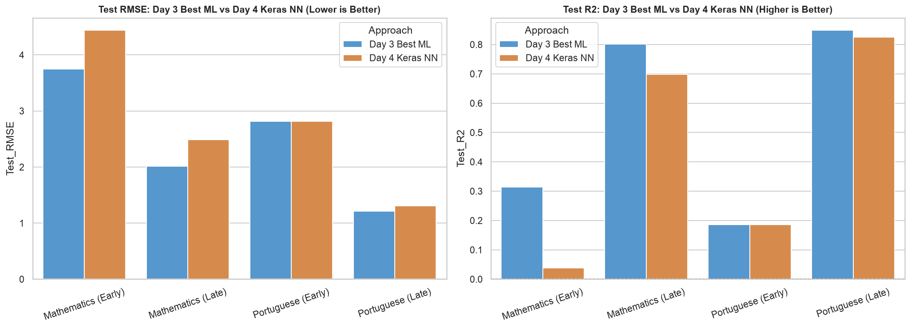

# EduPredict AI — Intelligent Student Performance Prediction System

**EduPredict AI** is an end-to-end educational machine learning, deep learning, and Generative AI web application that predicts high-school students' final grades (`G3`, scale `0–20`) and generates personalized study plans using **Scikit-learn**, **TensorFlow/Keras**, **FastAPI**, **Google Gemini**, and **Streamlit**.

---

## Features

- **Dual-Subject & Dual-Scenario Predictions:** Separate trained models for **Mathematics** and **Portuguese** across:
  - **Early Prediction (`early`):** Excludes prior grades (`G1`, `G2`) to identify at-risk students early using demographic, school, and study-habit features.
  - **Late Prediction (`late`):** Includes `G1` and `G2` for high-accuracy mid-year grade forecasting.
- **Classical ML + Deep Learning Comparison:** Defaults to the best classical Scikit-learn pipeline per task and optionally runs or compares predictions against TensorFlow/Keras Sequential neural networks (`model_type="ml" | "keras" | "both"`).
- **AI-Powered Personalized Study Plans:** Integrates the official `google-genai` SDK to produce structured, actionable study plans (`summary`, `strengths`, `risk_factors`, `weekly_study_plan`, `action_items`) with graceful fallback if Gemini is unavailable.
- **Modular REST API (FastAPI):** Validated Pydantic v2 schemas, CORS support, `/health`, `/models`, `/predict`, `/recommendations`, and interactive Swagger UI at `/docs`.
- **Interactive Dashboard (Streamlit + Plotly):** Four-page UI (`Overview`, `Student Prediction`, `AI Study Recommendations`, `Model Comparison`) with sample student presets, `st.session_state` workflow, and live Actual-vs-Predicted Plotly charts.
- **Leakage-Free Reproducible Notebooks:** Four executed Jupyter notebooks covering Data Setup, Visual EDA, Machine Learning, and Deep Learning.

---

## Technology Stack

| Layer | Technologies |
| :--- | :--- |
| **Language** | Python `3.13` |
| **Data & Numerical Analysis** | NumPy (`2.5.5`), Pandas (`3.1.1`) |
| **Static & Interactive Visualization** | Matplotlib (`3.11.2`), Seaborn (`0.13.2`), Plotly (`7.2.0`) |
| **Machine Learning** | Scikit-learn (`1.9.1`) — `LinearRegression`, `DecisionTreeRegressor`, `RandomForestRegressor`, `ColumnTransformer`, `Pipeline` |
| **Deep Learning** | TensorFlow (`2.21.0`) & Keras (`3.15.1`) — Sequential MLP (`64 → 32 → 16 → 1`) with `EarlyStopping` |
| **Backend API** | FastAPI (`0.165.0`), Uvicorn (`0.54.0`), Pydantic v2 |
| **Generative AI** | Google Gemini API via `google-genai` (`3.6.1`), `python-dotenv` (`1.2.4`) |
| **Frontend UI** | Streamlit (`1.67.0`), Requests (`2.34.2`) |
| **Notebooks & Testing** | Jupyter (`1.1.1`), Pytest (`9.2.0`) |

---

## Architecture

> See the complete layer-by-layer system diagram and prediction/recommendation data flows in [docs/architecture.md](docs/architecture.md).

```text
┌────────────────────────┐      HTTP (JSON)       ┌───────────────────────────────────┐
│   Streamlit Frontend   │ ─────────────────────► │         FastAPI Backend           │
│   (frontend/app.py)    │                        │         (backend/main.py)         │
│                        │ ◄───────────────────── │                                   │
│ • Overview             │   Predictions + Plans  │ • GET  /health                    │
│ • Student Prediction   │                        │ • GET  /models                    │
│ • AI Study Plans       │                        │ • POST /predict                   │
│ • Model Comparison     │                        │ • POST /recommendations           │
└────────────────────────┘                        └──────────┬─────────────┬──────────┘
                                                             │             │
                                            ┌────────────────▼──┐     ┌────▼──────────────────┐
                                            │   ModelService    │     │     GeminiService     │
                                            │  (models/*.joblib │     │  (google-genai SDK +  │
                                            │   & *.keras)      │     │   .env GEMINI_API_KEY)│
                                            └───────────────────┘     └───────────────────────┘
```

### Project Directory Structure

```text
.
├── backend/                     # FastAPI app, schemas, routes, ML/Gemini services & pytest suite
├── frontend/                    # Streamlit dashboard, API client, sample presets & AppTest suite
├── data/
│   ├── raw/                     # Unmodified UCI Student Performance CSVs & documentation
│   └── processed/               # Cleaned CSVs exported during Day 1 exploration
├── notebooks/
│   ├── 01_data_exploration.ipynb
│   ├── 02_eda_visualization.ipynb
│   ├── 03_machine_learning.ipynb
│   └── 04_deep_learning.ipynb
├── models/                      # Saved Scikit-learn pipelines (.joblib) & Keras models (.keras)
├── artifacts/                   # Evaluation CSVs/JSONs and 14 generated EDA/model charts
│   └── figures/
├── docs/                        # System architecture diagrams and technical documentation
│   └── architecture.md
├── .env.example                 # Safe environment variable template
├── .gitignore                   # Excludes .env, venv, __pycache__, checkpoints, temp files
├── requirements.txt             # Pinned compatible dependencies
└── README.md
```

---

## Dataset Information

This project uses the official **UCI Machine Learning Repository — Student Performance Dataset** (Dataset ID: `320`, P. Cortez & A. Silva, 2008).

- **Source:** [UCI Student Performance Archive](https://archive.ics.uci.edu/static/public/320/student+performance.zip)
- **Mathematics (`data/raw/student-mat.csv`):** `395` rows × `33` columns | `0` missing values | Mean `G3 = 10.42` | Pass Rate (`G3 >= 10`) = `67.09%`
- **Portuguese (`data/raw/student-por.csv`):** `649` rows × `33` columns | `0` missing values | Mean `G3 = 11.91` | Pass Rate (`G3 >= 10`) = `84.59%`
- **Features:** `30` demographic, family, school, and lifestyle attributes + `G1` (Period 1 grade), `G2` (Period 2 grade), and target `G3` (Final grade, `0–20`).
- **Re-downloading the raw dataset** (if needed):
  ```bash
  curl -fL "https://archive.ics.uci.edu/static/public/320/student+performance.zip" -o data/raw/student_performance.zip
  ```

---

## ML and DL Model Comparison

All models were evaluated on the exact same `80/20` train-test split (`random_state=42`) with `StandardScaler` + `OneHotEncoder` fitted strictly on training data to prevent leakage.

| Subject | Scenario | Best Classical ML (Day 3) | ML Test MAE | ML Test RMSE | ML Test R² | Keras NN Test MAE | Keras NN Test RMSE | Keras NN Test R² | Winner (Lowest Test RMSE) |
| :--- | :--- | :--- | ---: | ---: | ---: | ---: | ---: | ---: | :--- |
| **Mathematics** | Early (30 feats) | Random Forest Regressor | **2.9938** | **3.7508** | **0.3139** | 3.4899 | 4.4397 | 0.0387 | **Random Forest** |
| **Mathematics** | Late (32 feats) | Random Forest Regressor | **1.2005** | **2.0150** | **0.8020** | 1.8380 | 2.4890 | 0.6979 | **Random Forest** |
| **Portuguese** | Early (30 feats) | Random Forest Regressor | **2.0452** | 2.8166 | 0.1865 | 2.0679 | **2.8165** | 0.1865 | **Tie** (`-0.0001` RMSE) |
| **Portuguese** | Late (32 feats) | Linear Regression | **0.7651** | **1.2149** | **0.8487** | 0.9147 | 1.3043 | 0.8255 | **Linear Regression** |

**Key Observation:** On small tabular datasets (`395` / `649` rows), classical Scikit-learn models outperform or match the Dense Neural Networks across all tasks. Consequently, EduPredict AI uses the winning Day 3 Scikit-learn pipeline as the **default production model** while keeping Keras models available for interactive comparison.

---

## Gemini API Integration

- Uses the official **`google-genai`** SDK (`backend/services/gemini_service.py`) with structured JSON output (`StudyPlan` Pydantic schema).
- Reads `GEMINI_API_KEY` safely from `.env` via `python-dotenv` (reloads automatically if `.env` changes; never hardcoded or exposed in API responses/logs).
- Defaults to Google AI Studio (`generativelanguage.googleapis.com`) using `gemini-3.5-flash-lite` (configurable via `GEMINI_MODEL`, or Vertex AI via `GEMINI_USE_VERTEXAI=true`).
- **Fault Tolerance:** If Gemini is unconfigured, rate-limited (`429`), or unreachable, `POST /predict` and `POST /recommendations` still return valid ML/Keras predictions alongside a clear status message.

---

## Installation Instructions

1. **Clone the repository and enter the project directory:**
   ```bash
   git clone <your-repo-url>
   cd <project-folder>
   ```

2. **Create and activate a Python virtual environment** (Python `3.10–3.13`):
   ```bash
   python3 -m venv venv
   source venv/bin/activate        # macOS / Linux
   # venv\Scripts\activate         # Windows PowerShell
   ```

3. **Install dependencies:**
   ```bash
   pip install -r requirements.txt
   ```

4. **Configure environment variables:**
   ```bash
   cp .env.example .env
   ```
   Edit `.env` and add your Google Gemini API key from [Google AI Studio](https://aistudio.google.com/apikey):
   ```env
   GEMINI_API_KEY=your_real_gemini_api_key_here
   BACKEND_URL=http://127.0.0.1:8000
   ```
   > **Security Reminder:** Never commit `.env` or hardcode API keys in source files.

---

## How to Run Backend and Frontend

Run the FastAPI backend and Streamlit frontend in **two separate terminals** from the project root:

### Terminal 1 — Start FastAPI Backend
```bash
source venv/bin/activate
uvicorn backend.main:app --reload --host 127.0.0.1 --port 8000
```
- Interactive Swagger API Docs: `http://127.0.0.1:8000/docs`
- Health Check: `http://127.0.0.1:8000/health`

### Terminal 2 — Start Streamlit Frontend
```bash
source venv/bin/activate
streamlit run frontend/app.py --server.port 8501
```
- Dashboard URL: `http://127.0.0.1:8501`

### Run Automated Tests
```bash
source venv/bin/activate
pytest backend/tests frontend/tests -v
```

---

## Visualizations & Screenshots

Generated analysis and model evaluation plots are stored in `artifacts/figures/`:

### Mathematics vs Portuguese Performance Comparison


### Actual vs Predicted Final Grades (Best ML Models)


### Classical ML vs Keras Neural Network Comparison


> *(Add live screenshots of your running Streamlit dashboard and Swagger `/docs` UI here once deployed or captured.)*

---

## Limitations

1. **Small Dataset Size:** Mathematics (`395` rows) and Portuguese (`649` rows) are relatively small datasets; test metrics (`79` and `130` test samples) can vary across splits.
2. **Early Prediction Ceiling:** Excluding `G1` and `G2` yields lower Test R² (`0.3139` Math, `0.1865` Portuguese) because demographic and study-habit surveys alone cannot observe prior exam mastery or unmeasured classroom factors.
3. **Zero-Grade (`G3 = 0`) Dropouts:** Both datasets contain students who scored `G3 = 0` with `absences = 0` despite non-zero `G1`/`G2` grades (`38` in Math, `15` in Portuguese), inflating regression RMSE.
4. **Unbounded Linear Outputs:** Linear Regression and Linear-output Neural Networks can emit values slightly outside `[0, 20]`; the API preserves `raw_prediction` while clipping display `predicted_grade` to `[0.0, 20.0]`.
5. **External AI Dependency:** Gemini study recommendations require an active internet connection and valid API quota, though grade predictions continue working offline.
