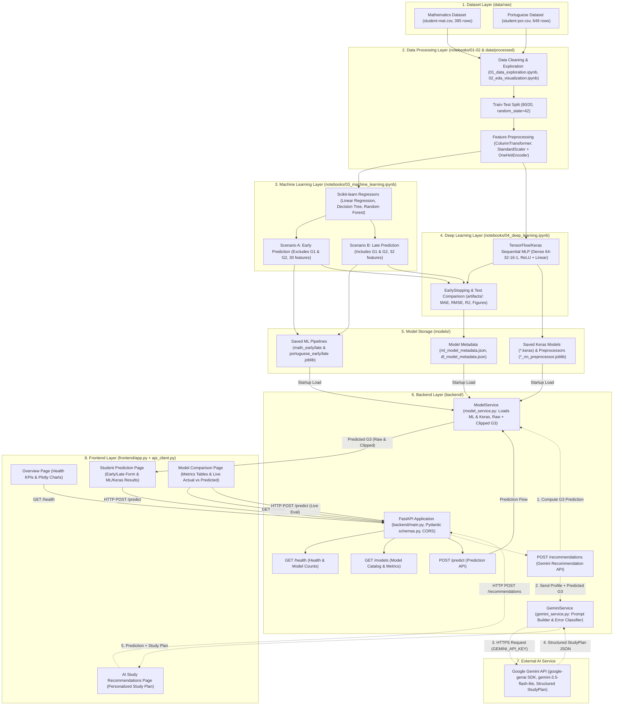
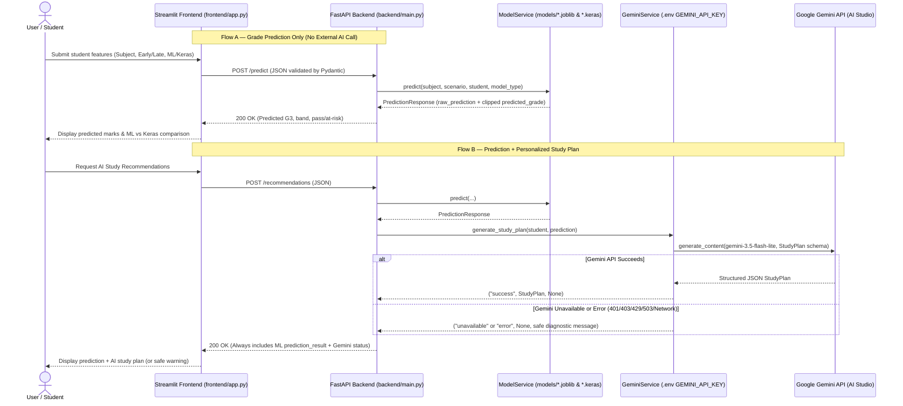

# EduPredict AI — System Architecture

This document describes the complete, verified architecture of **EduPredict AI - Intelligent Student Performance Prediction System**, covering the offline training pipeline (Datasets, Data Processing, Classical ML, Deep Learning, and Model Storage) and the online inference and AI advisory pipeline (Streamlit Frontend, FastAPI Backend, and Google Gemini API).

---

## 1. End-to-End System Architecture Diagram

- **Solid arrows (`-->`)** represent the data/training pipeline and **Prediction Flow** (`Streamlit -> FastAPI -> ModelService`).
- **Dashed arrows (`-.->`)** represent the **Gemini Recommendation Flow** (`Streamlit -> FastAPI -> GeminiService -> Google Gemini API`).

---

## 2. Runtime Prediction vs. Recommendation Flow

This sequence diagram highlights how **Prediction** (`POST /predict`) works independently offline, while **AI Study Recommendations** (`POST /recommendations`) combines `ModelService` and `Google Gemini API` with graceful degradation if Gemini is unavailable.

---

## 3. Layer-by-Layer Component Breakdown

| Layer | Implementation Files | Purpose & Verified Details |
| :--- | :--- | :--- |
| **1. Dataset Layer** | `data/raw/student-mat.csv`, `data/raw/student-por.csv`, `data/raw/student.txt` | Official UCI Student Performance dataset (ID `320`). Mathematics (`395` rows × `33` cols) and Portuguese (`649` rows × `33` cols), `0` missing values, target `G3` (`0–20`). |
| **2. Data Processing Layer** | `notebooks/01_data_exploration.ipynb`, `02_eda_visualization.ipynb`, `data/processed/*.csv` | Pandas/NumPy exploration, Seaborn/Matplotlib visual EDA, clean `80/20` train-test splits (`random_state=42`), and leakage-free `ColumnTransformer` (`StandardScaler` + `OneHotEncoder`). |
| **3. Machine Learning Layer** | `notebooks/03_machine_learning.ipynb` | Trains `LinearRegression`, `DecisionTreeRegressor`, and `RandomForestRegressor` for all 4 tasks (`Mathematics`/`Portuguese` × `early` without `G1/G2` vs `late` with `G1/G2`), selecting winners strictly on test RMSE. |
| **4. Deep Learning Layer** | `notebooks/04_deep_learning.ipynb`, `artifacts/*.csv`, `artifacts/figures/*.png` | Trains 4 TensorFlow/Keras `Sequential` MLPs (`Dense(64, relu) → Dense(32, relu) → Dense(16, relu) → Dense(1, linear)`) compiled with `Adam` + `MSE` + `MAE`, `EarlyStopping(patience=15)`, and compares test metrics against Day 3 ML models. |
| **5. Model Storage** | `models/*.joblib`, `models/*.keras`, `models/*_metadata.json` | Stores 4 complete Scikit-learn `Pipeline` objects, 4 native `.keras` neural networks, 4 fitted `*_nn_preprocessor.joblib` transformers, and JSON metadata recording winning models, feature lists, and test metrics. |
| **6. Backend Layer** | `backend/main.py`, `schemas.py`, `routes/prediction.py`, `routes/recommendation.py`, `services/model_service.py`, `services/gemini_service.py` | FastAPI REST service with Pydantic v2 validation, CORS for local UI origins, `lifespan` startup model loading, `GET /health`, `GET /models`, `POST /predict`, `POST /recommendations`, and Swagger docs at `/docs`. |
| **7. External AI Service** | Google Gemini API (`google-genai` SDK) | Generates structured `StudyPlan` JSON (`summary`, `strengths`, `risk_factors`, `weekly_study_plan`, `action_items`) using `GEMINI_API_KEY` loaded safely from `.env` via `python-dotenv`, with redacted logging and graceful fallback. |
| **8. Frontend Layer** | `frontend/app.py`, `frontend/api_client.py`, `frontend/sample_data.py` | Four-page Streamlit + Plotly dashboard (`Overview`, `Student Prediction`, `AI Study Recommendations`, `Model Comparison`) communicating strictly via HTTP with `st.session_state` and sample presets. |

